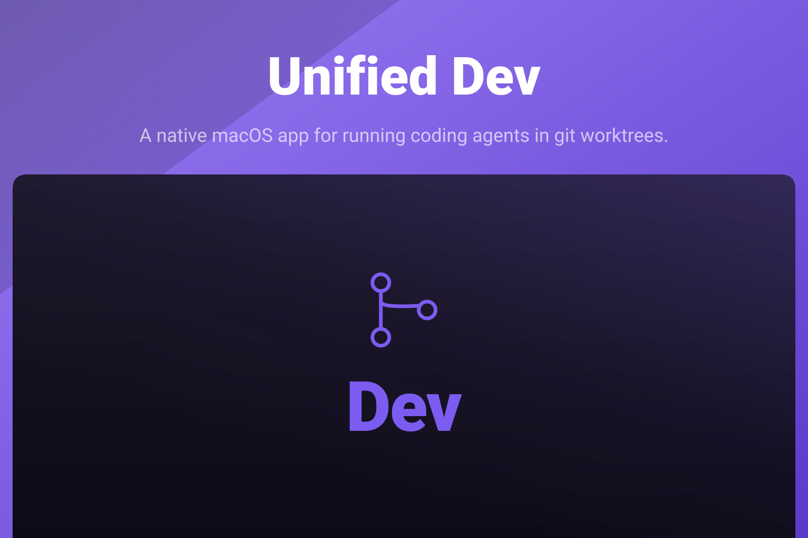

<p align="center">
  
</p>

<p align="center">
  <a href="https://github.com/akira-foundation/unified-dev-swift/releases/latest"></a>
  <a href="https://github.com/akira-foundation/unified-dev-swift/actions/workflows/test.yml"></a>
  
  
  
</p>

A native macOS app for running coding agents in git worktrees.

Every piece of work gets a workspace, and a workspace is a real worktree on disk with its own
branch. One agent runs in it, with its own terminal and its own diff, and nothing it does reaches
the branch anybody else is on. Several run at once.

One window holds all of it: a sidebar of projects and their workspaces, the agent's transcript in
the centre, a terminal below it, and an inspector on the right with the diff, the files and the
pull request.

It runs Claude Code, Codex, Grok, Cursor and OpenCode. The app finds the ones installed on the Mac
and asks for nothing to be typed in. An agent can also call back into the app it is running
inside, through an MCP bridge, to open a pane, read another workspace or ask for a review.

## Install

macOS 26 and an Apple silicon Mac. There is no Intel build.

Take the disk image from the [releases page](https://github.com/akira-foundation/unified-dev-swift/releases),
open it and drag Unified Dev into Applications. It is signed with a Developer ID and notarised by
Apple, so it opens without going into System Settings.

It checks GitHub Releases for a newer version once a day, never while an agent is running, and
tells you rather than acting: nothing is downloaded or installed until you press Install, because
installing restarts the app and this app holds agents in the middle of a turn. The check can be
turned off in Settings.

The agent CLIs are not bundled. Install the ones you want and the app finds them.

### Building from source

macOS 26, Xcode 26 for the toolchain, Swift 6.2, SwiftPM, language mode 6. There is no Xcode
project and that is deliberate, for reasons written out in [CLAUDE.md](CLAUDE.md). Open
`Package.swift` in Xcode and it builds, runs, debugs and previews.

```sh
git clone https://github.com/akira-foundation/unified-dev-swift.git
cd unified-dev-swift
make build
make app
```

Everything real is a script in `Tools/`, and `make` with no target lists them.

## Documentation

- [docs/ARCHITECTURE.md](docs/ARCHITECTURE.md): the five targets and the line between them
- [docs/AGENTS-INTEGRATION.md](docs/AGENTS-INTEGRATION.md): how each agent CLI is detected and what it needs
- [docs/PROTOCOL.md](docs/PROTOCOL.md): Claude Code's stream-json
- [docs/CODEX.md](docs/CODEX.md): the Codex app-server protocol as measured
- [docs/GROK.md](docs/GROK.md): Grok's ACP over stdio
- [docs/BRIDGE.md](docs/BRIDGE.md): the MCP bridge and which callers may call what
- [docs/CHAT-SEGMENTS.md](docs/CHAT-SEGMENTS.md): one chat run by several agents in turn
- [docs/SIDE-CONVERSATIONS.md](docs/SIDE-CONVERSATIONS.md): side conversations
- [docs/PROFILES.md](docs/PROFILES.md): the groups of projects the window shows one at a time
- [docs/PREVIEW-APPS.md](docs/PREVIEW-APPS.md): the preview app every worktree can build
- [docs/EDITOR.md](docs/EDITOR.md): the code editor
- [docs/MENUS.md](docs/MENUS.md): the menus
- [docs/CRASH-REPORTING.md](docs/CRASH-REPORTING.md): crash reporting
- [docs/PLAN.md](docs/PLAN.md): what was built and in what order
- [RELEASING.md](RELEASING.md): signing, notarising and publishing a release
- [CLAUDE.md](CLAUDE.md) and [AGENTS.md](AGENTS.md): the working agreement for anybody, human or
  agent, changing this repository

## Testing

```sh
make lint && make swiftlint && make build && make test && make test-browser
```

`make test` runs the Core suite through `./Tools/test-core.sh`, which mirrors the core sources
into a package with no app target; pass a suite name to run one, as in
`./Tools/test-core.sh DiffParser`. A green suite does not prove the app compiles, and neither
suite compiles the other, which is why `make build` and `make test-browser` are in the line too.

## Changelog

Please see [CHANGELOG.md](CHANGELOG.md) for what has changed recently. The changelog is generated
from conventional commits via [git-cliff](https://git-cliff.org) on every release tag.

## Contributing

Please see [CONTRIBUTING.md](CONTRIBUTING.md) for details.

## Security Vulnerabilities

Please review [our security policy](SECURITY.md) on how to report security vulnerabilities.

## Credits

- [Kidiatoliny](https://github.com/kidiatoliny)
- [All Contributors](https://github.com/akira-foundation/unified-dev-swift/graphs/contributors)

## Licence

GNU Affero General Public License v3. See [LICENSE](LICENSE), and
[LICENSE-THIRD-PARTY.md](LICENSE-THIRD-PARTY.md) for what is vendored.

Unless you explicitly state otherwise, any contribution intentionally submitted for inclusion in
this project by you shall be licensed under the same terms, without any additional terms or
conditions.
